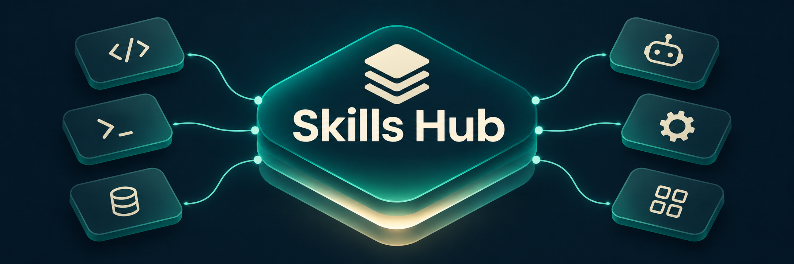

<p align="center">
  
</p>

<h1 align="center">Skills Hub</h1>

<p align="center">
  <strong>English</strong> · <a href="README.vi.md">Tiếng Việt</a>
</p>

One shared home for coding-agent skills: Claude Code, Codex, Antigravity, Gemini CLI, Cursor, OpenCode, Copilot, Windsurf, and more.

Keep each shared skill in one place. Agents use the same files, so an edit in the hub is available wherever that skill is linked or discovered. Skills that deliberately differ between agents remain separate.

## Find a skill

Browse the [generated skill catalog](CATALOG.md) for all published skill names, grouped by source and purpose. It includes upstream links and installation guidance, and excludes machine-only skills.

| What you need | Where to start |
|---|---|
| Build, test, debug, or review software | ECC, superpowers, gstack |
| Plan and deliver a project | gsd-core, OpenSpec, claude-task-master |
| Research or analyze scientific data | scientific-agent-skills |
| Write documents, presentations, or README files | anthropics-skills, `bilingual-readme` |
| Think through a difficult problem | `first-principles-skill`, `inquiry-and-problem-framing`, `thinking-loop` |
| Build on Cloudflare | cloudflare-skills |

Regenerate the catalog after staging skill or source-lock changes:

```bash
python3 bin/generate-catalog.py
python3 bin/generate-catalog.py --check
```

The generator reads Git's index, so untracked local installations do not appear.

## Quick start

You need Git, Python 3, and Node.js with `npx`. The optional daily sync uses a systemd user timer.

```bash
git clone https://github.com/awun0105/skills-hub.git ~/.agents
~/.agents/bin/install.sh
```

The installer:

1. Clones missing upstream skill repositories into `~/.agents/repos/` at the commits recorded in `repos.lock`. Existing clones are left in place.
2. Restores missing skills listed in `.skill-lock.json` using `npx skills`.
3. Creates missing skill symlinks for Claude Code and Windsurf when their configuration directories exist. It leaves existing destinations alone.

It also lists skills supplied by external apps that this repository does not redistribute. Restart your agents after installation.

Clone into `~/.agents`: the installer and skill tooling use that location. If it already exists, preserve it before cloning and merge the files you need afterward. The hub uses relative links and `$HOME` rather than a fixed username.

Agent discovery varies by tool and version. The installer treats Codex, Cursor, Gemini CLI, Antigravity, and OpenCode as direct readers of `~/.agents/skills`; check your agent's configured skill paths if a skill does not appear.

## Repository layout

```text
~/.agents/
├── skills/              # Shared skills: real directories or links into repos/
├── repos/               # Upstream clones; restored from repos.lock, not committed
├── rules/               # Shared rules
├── workflows/           # Shared workflows and slash commands
├── bin/
│   ├── install.sh             # Set up the hub on a machine
│   ├── consolidate-skills.sh  # Inspect or consolidate scattered skills
│   ├── repos-lock.sh          # Record or restore upstream clones
│   ├── sync-hub.sh            # Consolidate and sync managed changes
│   └── generate-catalog.py    # Generate the tracked skill catalog
├── overlays/            # Local additions applied to restored upstream clones
├── systemd/             # Optional daily sync service and timer
├── assets/              # README artwork
├── repos.lock           # Upstream paths, URLs, and commits
├── .skill-lock.json     # Source records maintained by npx skills
├── README.md            # English documentation
└── README.vi.md         # Vietnamese documentation
```

A typical shared-skill path:

```text
~/.claude/skills/<name> → ~/.agents/skills/<name> → ~/.agents/repos/.../<name>
```

## Everyday use

### Install a skill from a repository

```bash
npx skills add <owner>/<repo> --list
npx skills add <owner>/<repo> --skill <name> -g -y
```

`-g` installs globally; `-y` accepts the installer's prompts. Source-managed skills are restored from the records in `.skill-lock.json` rather than redistributed as copies in this repository. The sync script updates the corresponding ignore entries.

### Write your own skill

Create `~/.agents/skills/<name>/SKILL.md`. Link it into any agent directory that needs an explicit link, for example Claude Code:

```bash
mkdir -p ~/.claude/skills
ln -s ~/.agents/skills/<name> ~/.claude/skills/<name>
cd ~/.agents
git add skills/<name>
git commit -m "Add skill <name>"
git push
```

Use the hub as the source of truth instead of creating separate real copies in each agent's directory. Project-specific skills stay in their project repositories.

### Edit a skill

Edit `~/.agents/skills/<name>/`. Agents reading that path share the change; restart an agent if it caches skills.

If the directory is a symlink into `repos/`, edits belong to the upstream clone and are not captured by a hub commit. To retain them, commit to your own fork, store suitable additions in `overlays/`, or maintain a real local copy under `skills/`. Check the upstream license before redistributing a modified copy.

### Find scattered skills

```bash
~/.agents/bin/consolidate-skills.sh          # Inspect only
~/.agents/bin/consolidate-skills.sh --apply  # Consolidate and create links
```

| Status | Meaning | Behavior with `--apply` |
|---|---|---|
| `new` | A real skill is missing from the hub | Copy into the hub and replace its original location with a link |
| `dup` | Content matches the hub copy | Replace the duplicate location with a link |
| `CONFLICT` | Same name, different content | Preserve the conflict in a backup for manual resolution |
| `per-host` | An intentional agent-specific variant | Skip |
| `ext-link` | A link outside the managed hub | Skip |

Originals moved by consolidation are kept in `~/skills-backup-<timestamp>/`.

### Enable daily sync

For maintainers with push access:

```bash
~/.agents/bin/install.sh --sync
```

The systemd user timer runs at 21:00 and 15 minutes after the user service manager starts. Sync consolidates scattered skills, updates `repos.lock` and skill ignore entries, then commits and pushes only `.gitignore`, `.skill-lock.json`, `repos.lock`, and changes to already tracked files under `skills/`.

New skill paths, backups, README edits, and other repository files stay outside automatic publication. Publish those explicitly after review. Sync stops before consolidation if the index contains staged changes or the branch has unpushed commits; resolve those first.

Preview consolidation and candidate commit paths without changing hub files, the index, commits, or remotes. Consolidation can change tracked skills during a real run, so inspect its proposal too:

```bash
~/.agents/bin/sync-hub.sh --dry-run
```

```bash
journalctl --user -u skills-hub-sync -n 30
~/.agents/bin/sync-hub.sh
```

## What a clone does not include

| Source | Examples | How to restore |
|---|---|---|
| Upstream repositories | superpowers, gstack, ECC, OpenSpec | `repos.lock` and `bin/install.sh` |
| Skills installed through `npx skills` | archify, architecture-diagram, svg-diagram, supabase | `.skill-lock.json` and `bin/install.sh` |
| App-managed skills not redistributed here | orca-*, hf-cli, colab-operator, use-railway, computer-use | Install the relevant app or tool |
| Machine-generated skills or extension links | `_gstack-command`, Gemini extension links | Run upstream setup or install the extension |

A skill being present on the maintainer's machine does not mean its contents are published in this repository. Redistribution depends on its source and license.

## Maintenance notes

- **Preserve agent-specific variants.** Consolidation excludes `gstack`, `graphify`, and `connect-chrome` by default. Set `PER_HOST` to customize that list.
- **Keep upstream edits reproducible.** `repos.lock` records commits, not uncommitted files. Push edits to your fork or place additions under `overlays/<repo-path>/...`; restore applies those overlays after cloning. Lock generation warns about uncommitted files without matching overlays.
- **Review what you publish.** Stage intended paths and inspect the diff before committing. `.gitignore` excludes `.env` files, but it does not replace reviewing the staged content.
- **Review third-party skills before use.** Skills execute through an agent's available tools and permissions.
- **Leave project skills in their projects.** Do not consolidate a project's `.claude/skills/` into the global hub.

## Troubleshooting

| Symptom | What to check |
|---|---|
| An agent cannot see a newly installed skill | Restart the agent and inspect its discovery paths or `ls -la ~/.claude/skills/<name>` |
| A link under `skills/` is broken | Run `bin/repos-lock.sh restore` for missing upstream clones, or `bin/install.sh` for a full setup |
| `Too many levels of symbolic links` | Inspect each link with `readlink`; replace one end of the cycle with the real directory from a backup |
| Consolidation needs to be undone | Locate the original in `~/skills-backup-<timestamp>/<agent>/<name>`, remove the replacement link, and move the original back |

Find broken links:

```bash
find ~/.agents/skills ~/.claude/skills -maxdepth 1 -xtype l
```

## Credits

- `skills/first-principles-skill` is adapted from [awesome-skills/first-principles-skill](https://github.com/awesome-skills/first-principles-skill), under the MIT license; see its `LICENSE`. The local v0.2.1 adaptation adds keywords and Vietnamese writing guidance.
- Skills restored into `repos/` remain the work of their respective authors and follow each upstream repository's license.
