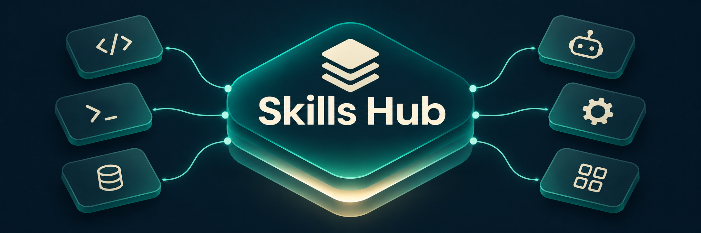

<p align="center">
  
</p>

<h1 align="center">Skills Hub</h1>

<p align="center">
  <a href="README.md">English</a> · <strong>Tiếng Việt</strong>
</p>

Nơi chứa **tất cả skill** của mọi coding agent trên máy: Claude Code, Codex, Antigravity, Gemini CLI, Cursor, OpenCode, Copilot, Windsurf…

Mỗi skill chỉ có **một bản duy nhất** nằm ở đây. Agent nào cũng dùng chung bản đó, nên sửa một chỗ là mọi agent đều thấy.

## Tìm skill phù hợp

Xem [catalog skill được tạo tự động](CATALOG.md) để tra tên skill theo nhóm chức năng và nguồn. Catalog có liên kết upstream, hướng dẫn cài đặt và không đưa các skill chỉ có trên máy vào danh sách.

| Nhu cầu | Nhóm hoặc skill nên xem |
|---|---|
| Viết code, kiểm thử, debug, review | ECC, superpowers, gstack |
| Lập kế hoạch và triển khai dự án | gsd-core, OpenSpec, claude-task-master |
| Nghiên cứu và phân tích dữ liệu khoa học | scientific-agent-skills |
| Viết tài liệu, trình chiếu, README | anthropics-skills, `bilingual-readme`, `vietnamese-writing` |
| Phân tích vấn đề và lựa chọn hướng giải quyết | `first-principles-skill`, `inquiry-and-problem-framing`, `thinking-loop` |
| Xây dựng ứng dụng trên Cloudflare | cloudflare-skills |

Tạo lại catalog sau khi stage thay đổi skill hoặc lock file nguồn:

```bash
python3 bin/generate-catalog.py
python3 bin/generate-catalog.py --check
```

Script đọc index của Git, nên các bản cài local chưa được track không xuất hiện trong catalog.

## Cài đặt (máy mới, hoặc bạn muốn dùng bộ skill này)

Cần có `git`, `python3`, và Node.js (cho `npx`).

```bash
git clone https://github.com/awun0105/skills-hub.git ~/.agents
~/.agents/bin/install.sh
```

Script sẽ làm 3 việc:
1. Clone các repo skill gốc (superpowers, gstack, ECC…) vào `~/.agents/repos/`, đúng commit đã ghi trong `repos.lock` nếu clone mới; clone đã có được giữ nguyên.
2. Cài lại các skill trong `.skill-lock.json` bằng `npx skills`, lấy thẳng từ nguồn.
3. Tạo symlink cho những agent không tự đọc `~/.agents/skills`, cụ thể là Claude Code và Windsurf. Script hiện coi các agent còn lại (Codex, Cursor, Gemini CLI, Antigravity, OpenCode…) là đọc trực tiếp thư mục này. Cách tìm skill có thể khác theo công cụ và phiên bản; nếu không thấy skill, hãy kiểm tra đường dẫn skill của agent.

Cuối cùng script in ra danh sách skill **không có trong repo** vì do app tự cài (xem [bên dưới](#những-gì-không-có-trong-repo)).

> **Nhất định phải clone vào `~/.agents`.** Đó là thư mục mà `npx skills` và nhiều agent tự tìm đến. Nếu bạn đã có sẵn `~/.agents`, hãy đổi tên nó trước (`mv ~/.agents ~/.agents.old`), clone xong thì copy những gì cần giữ sang.

Repo này dùng **đường dẫn tương đối** (`skills/x -> ../repos/...`) và `$HOME`, nên chạy được với mọi tên user.

---

## Cấu trúc

```
~/.agents/
├── skills/        ← HUB: mọi skill (thư mục thật, hoặc symlink vào repos/)
├── repos/         ← các git clone gốc — không commit, ghi trong repos.lock
├── assets/        ← banner dùng cho README
├── README.md      ← tài liệu tiếng Anh (bản chính)
├── README.vi.md   ← tài liệu tiếng Việt
├── rules/         ← rule dùng chung
├── workflows/     ← workflow / slash command dùng chung
├── bin/
│   ├── install.sh              ← cài lên máy mới
│   ├── consolidate-skills.sh   ← tìm và gom skill nằm rời rạc về hub
│   ├── repos-lock.sh           ← ghi / khôi phục danh sách git clone
│   ├── sync-hub.sh             ← gom + đồng bộ các thay đổi trong phạm vi quản lý
│   └── generate-catalog.py     ← tạo catalog từ danh sách skill đã tracked
├── overlays/      ← file thêm vào repo của người khác, được chép đè sau khi clone
├── systemd/       ← timer cho sync-hub.sh
├── repos.lock     ← danh sách repo: đường dẫn, URL, commit
└── .skill-lock.json  ← file của `npx skills`, đừng sửa tay

~/.claude/skills/<tên>  ──►  ~/.agents/skills/<tên>  ──►  ~/.agents/repos/.../<tên>
```

---

## Việc hằng ngày

### Cài skill mới

```bash
npx skills add <chủ>/<repo> --list                     # xem repo có những skill nào
npx skills add <chủ>/<repo> --skill <tên> -g -y         # cài cho mọi agent trên máy
```

`-g` nghĩa là cài toàn cục, vào `~/.agents/skills`. `-y` nghĩa là tự chọn mọi agent tìm thấy, không hỏi lại. Skill cài theo cách này **không được commit**: chỉ tên và nguồn được ghi vào `.skill-lock.json`, và máy khác sẽ tự cài lại từ nguồn.

### Tự viết skill

Tạo ở `~/.agents/skills/<tên>/SKILL.md`, rồi link sang Claude Code:

```bash
ln -s ~/.agents/skills/<tên> ~/.claude/skills/<tên>
cd ~/.agents && git add skills/<tên> && git commit -m "Add skill <tên>" && git push
```

Nếu bạn nhờ agent tạo skill thì không cần làm tay. File cấu hình chung của từng agent (`~/.claude/CLAUDE.md`, `~/.codex/AGENTS.md`, `~/.gemini/GEMINI.md`) đã có hướng dẫn để agent tự làm đúng các bước trên.

### Sửa một skill

Sửa thẳng trong `~/.agents/skills/<tên>/`. Mọi agent dùng bản đã sửa ngay.

> ⚠️ Nếu `skills/<tên>` là **symlink vào `repos/`**, tức là skill của người khác, thì phần bạn sửa nằm trong repo gốc, **không** vào git của hub, và có thể bị ghi đè khi repo gốc cập nhật. Muốn giữ bản sửa riêng thì copy ra thành thư mục thật. Lưu ý chỉ public bản sửa nếu license của skill gốc cho phép.
> ```bash
> cd ~/.agents/skills && cp -rL <tên> <tên>.tmp && rm <tên> && mv <tên>.tmp <tên>
> ```

### Kiểm tra có skill nào bị "lạc" không

Đôi khi một công cụ tự cài skill thẳng vào `~/.claude/skills` thay vì vào hub. Để kiểm tra:

```bash
~/.agents/bin/consolidate-skills.sh            # chỉ xem, KHÔNG thay đổi gì
~/.agents/bin/consolidate-skills.sh --apply    # gom về hub
```

| STATUS | Nghĩa | Script làm gì khi `--apply` |
|---|---|---|
| `new` | Skill thật, hub chưa có | Copy vào hub, thay bản gốc bằng symlink |
| `dup` | Giống hệt bản trong hub | Thay bằng symlink |
| `CONFLICT` | Cùng tên nhưng nội dung khác | **Không đụng vào.** Copy sang thư mục backup để bạn tự chọn bản giữ lại |
| `per-host` | Skill cố ý khác nhau theo agent | Bỏ qua |
| `ext-link` | Symlink trỏ ra ngoài hub | Bỏ qua |

Bản gốc **không bao giờ bị xoá**, mà được chuyển vào `~/skills-backup-<ngày-giờ>/`.

### Tự đồng bộ mỗi ngày (chỉ dành cho chủ repo)

```bash
~/.agents/bin/install.sh --sync
```

Lệnh này bật một systemd timer chạy lúc 21:00 và 15 phút sau khi trình quản lý dịch vụ user khởi động. Mỗi lần chạy, timer gom skill lạc về hub, cập nhật `repos.lock` và các mục ignore, rồi chỉ commit/push `.gitignore`, `.skill-lock.json`, `repos.lock` cùng thay đổi của các file đã tracked trong `skills/`.

Đường dẫn skill mới, backup, thay đổi README và các file khác không được tự phát hành. Những phần này cần được review và commit riêng. Script dừng trước bước gom skill nếu index đang có thay đổi staged hoặc nhánh có commit chưa push; cần xử lý các phần đó trước.

Xem trước đề xuất gom skill và các đường dẫn dự kiến commit mà không sửa file trong hub, index, commit hay remote. Bước gom thực tế có thể làm thay đổi skill đã tracked, vì vậy cần đọc cả đề xuất gom:

```bash
~/.agents/bin/sync-hub.sh --dry-run
```

Xem log: `journalctl --user -u skills-hub-sync -n 30`

Đồng bộ tay: `~/.agents/bin/sync-hub.sh`

---

## Những gì không có trong repo

| Loại | Ví dụ | Cách có lại |
|---|---|---|
| Repo skill gốc | superpowers, gstack, ECC, OpenSpec… | `repos.lock`, `install.sh` tự clone |
| Cài qua `npx skills` | archify, architecture-diagram, svg-diagram, supabase | `.skill-lock.json`, `install.sh` tự cài |
| Do app/tool tự cài, không rõ license | orca-*, hf-cli, colab-operator, use-railway, computer-use… | Cài app tương ứng |
| Sinh ra theo máy | `_gstack-command`, các link vào extension của Gemini | Chạy `./setup` của gstack, cài extension |

Những skill này **vẫn có trên máy chủ repo**, chỉ không được phát hành lại. Lý do là repo public sẽ phân phối bản sao nội dung của người khác, và việc đó cần license cho phép.

---

## Những điều cần nhớ

1. **Đừng gộp skill `per-host`.** Hiện có `gstack`, `graphify` và `connect-chrome`. Mỗi agent có một bản riêng là có chủ đích, ví dụ bản Codex gọi `spawn_agent` còn bản Claude gọi Agent tool. Muốn thêm tên vào danh sách này thì đặt biến `PER_HOST`.
2. **Thay đổi chưa commit trong `repos/` không đi theo sang máy khác.** `repos.lock` chỉ ghi commit. Có hai cách giữ phần bạn thêm vào:
   - Repo là fork của bạn: commit và push trong chính repo đó.
   - Repo của người khác: đặt file vào `overlays/<đường dẫn repo>/...`. `repos-lock.sh restore` sẽ chép đè chúng vào sau khi clone. Hiện có `plugin.json` của OpenSpec và skill `taskmaster` cùng plugin của claude-task-master.

   `repos-lock.sh save` sẽ cảnh báo nếu một file chưa commit không có bản giống hệt trong `overlays/`.
3. **Không commit bí mật.** `.gitignore` đã chặn `.env`, nhưng trước khi push bạn vẫn nên liếc qua `git status`.
4. **Skill chạy với toàn quyền của agent.** Trước khi cài skill lạ, xem điểm đánh giá bảo mật trên `skills.sh/<chủ>/<repo>`.
5. **Skill cấp project** (`.claude/skills/` bên trong một repo dự án) để nguyên ở đó, không gom về hub.

---

## Khi có sự cố

| Triệu chứng | Cách xử lý |
|---|---|
| Agent không thấy skill vừa cài | Khởi động lại agent. Kiểm tra `ls -la ~/.claude/skills/<tên>` có trỏ đúng không |
| Symlink trong `skills/` bị hỏng | Chạy `bin/repos-lock.sh restore` (thiếu repo gốc) hoặc `bin/install.sh` |
| `Too many levels of symbolic links` | Có vòng lặp symlink. Chạy `readlink` trên từng mắt xích, rồi thay một đầu bằng thư mục thật (lấy từ `~/skills-backup-*`) |
| Lỡ `--apply` sai | Bản gốc nằm trong `~/skills-backup-<ngày-giờ>/<agent>/<tên>`. Xoá symlink rồi `mv` bản gốc về |

Tìm symlink hỏng:

```bash
find ~/.agents/skills ~/.claude/skills -maxdepth 1 -xtype l
```

---

## Ghi công

- `skills/first-principles-skill`: từ [awesome-skills/first-principles-skill](https://github.com/awesome-skills/first-principles-skill), license MIT (xem `LICENSE` trong thư mục). Bản ở đây đã được sửa (v0.2.1): thêm từ khoá và quy tắc diễn đạt tiếng Việt.
- Các skill trong `repos/` thuộc về tác giả của từng repo, theo license của repo đó.
